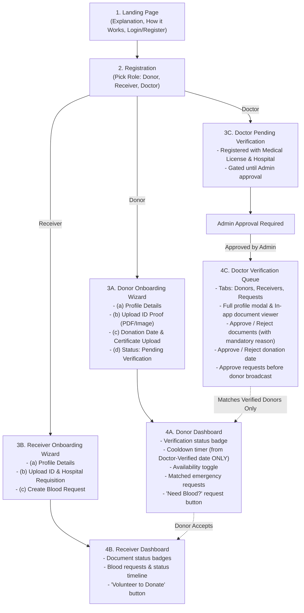

# LifeLink — Doctor-Supervised Emergency Blood Coordination Platform

LifeLink is a doctor-supervised emergency blood coordination platform connecting critical hospital deficits to verified, cooldown-eligible donors with zero spam and zero unverified forwards.

---

## 1. System Architecture & User Flow



---

## 2. Tech Stack

- **Frontend**: React 18, Vite, React Router v6, Lucide Icons, Plain CSS. Pure JavaScript (`.jsx` / `.js`) with zero TypeScript.
- **Backend**: Node.js, Express 4 (ES Modules). Pure JavaScript (`.js`) with zero TypeScript.
- **Database**: PostgreSQL (Neon connection pool) with transactional schema and in-memory test fallback.
- **Authentication**: Email + password (hashed with `bcryptjs`) + JSON Web Tokens (JWT).
- **Private File Storage**: `multer` storing files in a private directory (`server/uploads/private/`), with a stream abstraction (`storageService.js`) and in-app authenticated viewer.

---

## 3. Quick Setup Guide (Under 10 Steps)

Follow these simple steps to run LifeLink locally:

### Step 1: Clone or Open the Workspace
Open a terminal in the project root directory (`Olympus2K26`).

### Step 2: Install Backend Dependencies
```bash
cd server
npm install
```

### Step 3: Install Frontend Dependencies
```bash
cd ../client
npm install
```

### Step 4: Configure Environment Variables
Copy the template `.env.example` file in the root to `.env` in the root:
```bash
cd ..
cp .env.example .env
```
*(Optional: paste your Neon PostgreSQL connection string in `DATABASE_URL`. If left empty, LifeLink runs seamlessly with the built-in local database engine).*

### Step 5: Seed the Database
Seed the database with 1 user per role (Admin, Doctor, Donor, Receiver):
```bash
npm --prefix server run seed
```

### Step 6: Run Automated Tests
Verify all 16 unit and workflow tests pass:
```bash
npm test
```

### Step 7: Build Frontend
Verify Vite builds without any errors:
```bash
npm --prefix client run build
```

### Step 8: Start the API Server
In terminal 1:
```bash
npm --prefix server run dev
```
*Backend runs on `http://localhost:5000`.*

### Step 9: Start the Frontend Client
In terminal 2:
```bash
npm --prefix client run dev
```
*Frontend opens on `http://localhost:5173` with automated API proxying.*

---

## 4. Default Seeded Credentials

All pre-seeded test accounts use the password: `Password123!`

| Role | Name | Email | Password | Access & Responsibilities |
|---|---|---|---|---|
| **ADMIN** | System Administrator | `admin@lifelink.org` | `Password123!` | Approves or rejects doctor registrations. |
| **DOCTOR** | Dr. Rajesh Sharma, MD | `doctor@hospital.org` | `Password123!` | Verifies donor documents, donation dates, and requisitions. |
| **DONOR** | Aarav Patil (O-) | `donor@example.com` | `Password123!` | Cooldown timer, availability toggle, emergency matching. |
| **RECEIVER** | Priya Deshmukh | `receiver@example.com` | `Password123!` | Document status, request tracking timeline. |

---

## 5. Security & Clinical Protocol Rules

1. **Strict Doctor Verification Gating**: Unapproved doctor accounts see nothing. Only approved physicians can view donor/patient queues.
2. **Clinical Cooldown Rule**: Donor cooldown is mathematically computed **only** from a doctor-verified donation date. Pending or unverified dates do not grant cooldown clearance.
3. **Verified Donors Only**: Blood requests are broadcast **only** to donors verified by a licensed doctor.
4. **Private Document Storage**: All uploaded identity cards and hospital requisitions are stored privately outside public web paths and streamed solely through authenticated endpoints with permission checks.
5. **Universal Cross-Role Support**: Donors can submit emergency requests if they or their families need blood; receivers can volunteer to donate blood once stable.
