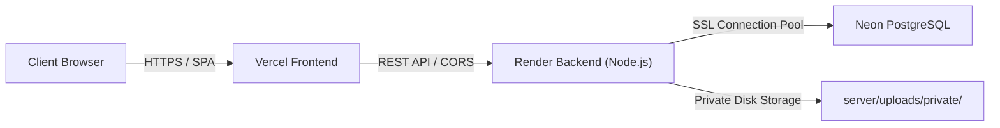

# LifeLink — Project Context & Master Reference (`antigravity.md`)

> **Single Source of Truth** for the LifeLink emergency blood coordination platform.  
> *Antigravity AI Agent Instruction*: Read this file first to understand the architecture, data flows, database schemas, API routes, design system, and operational rules before inspecting or modifying source code.

---

## A. Project Overview

* **Application Name**: LifeLink
* **What the Application Does**: LifeLink is a doctor-supervised, privacy-first emergency blood coordination platform. It bridges critical hospital blood shortages directly to verified, cooldown-eligible blood donors while eliminating fake forwards, panic broadcasts, and spam calls.
* **Main Purpose & Goals**:
  1. **Physician Verification First**: Ensure every emergency blood requisition and donor credential is independently verified by a licensed hospital doctor before any donor is notified.
  2. **Clinical Cooldown Integrity**: Donor eligibility and cooldown timers are calculated **strictly** from a doctor-verified previous donation date and proof, preventing medically premature or unverified donations.
  3. **Privacy by Design**: Volunteer donor contact numbers are concealed until the donor explicitly accepts a blood match. Uploaded identity cards and prescriptions are stored in a private directory and served only via authenticated streaming.
  4. **Universal Emergency Flexibility**: Real-world bidirectional participation—registered donors can submit blood requests if they or their families need emergency blood, and registered receivers can volunteer to donate blood once stable.
* **Target Users & Roles**:
  * **DONOR**: Volunteers offering whole blood donations. Subject to ID verification, donation date verification, and a 90-day cooldown interval.
  * **RECEIVER**: Patients or their attendants requesting blood units for hospital emergencies. Subject to ID and hospital requisition verification.
  * **DOCTOR**: Licensed hospital physicians. Account is gated pending Admin verification. Once approved, reviews donor credentials, patient requisitions, and approves/rejects requests.
  * **ADMIN**: Platform administrators responsible for approving/rejecting doctor accounts based on medical license and hospital credentials.
* **Core Functionality**:
  * Linear multi-step onboarding wizard for Donors and Receivers.
  * Private file upload subsystem for government IDs and medical prescriptions (JPG, PNG, PDF $\le$ 5 MB).
  * In-app document previewer and download streamer.
  * Doctor triage queue with full profile modals and mandatory rejection reasons.
  * Hematological Red Blood Cell (RBC) compatibility matching matrix.
  * Admin doctor verification portal.
  * Silent background polling for real-time dashboard updates without page reloads.

---

## B. Technology Stack

### Frontend
* **Core**: React 18 (`react` `^18.3.1`, `react-dom` `^18.3.1`)
* **Build Tool & Dev Server**: Vite 6 (`vite` `^6.0.3`, `@vitejs/plugin-react` `^4.3.4`)
* **Routing**: React Router DOM v6 (`react-router-dom` `^6.28.0`)
* **Icons**: Lucide React (`lucide-react` `^0.468.0`)
* **Mapping**: Leaflet (`leaflet` `^1.9.4`) *(Present in package dependencies; currently deferred to `/features-later`)*
* **Styling**: Plain Vanilla CSS (`client/src/index.css`) with CSS custom properties (variables), responsive flexbox/grid layout, and zero CSS preprocessors/Tailwind.
* **Language**: Pure JavaScript (`.jsx` / `.js`) — TypeScript was strictly replaced to maintain accessibility and speed.

### Backend
* **Runtime**: Node.js (v18+ recommended)
* **Web Framework**: Express 4 (`express` `^4.21.2`, standard ES Modules `import/export`)
* **Authentication**: JSON Web Tokens (`jsonwebtoken` `^9.0.2`) + password hashing with `bcryptjs` `^3.0.2` (10 salt rounds)
* **File Uploads**: Multer (`multer` `^2.5.0`) with disk storage into a private workspace folder
* **CORS & Environment**: `cors` `^2.8.5`, `dotenv` `^16.4.7`
* **Language**: Pure JavaScript (`.js`) — ES Modules with zero TypeScript.

### Database
* **Primary Database**: PostgreSQL via Neon Cloud Serverless (`pg` `^8.13.1` connection pool with SSL)
* **Fallback / Testing Database**: Built-in in-memory relational simulation engine (`MemoryDB` in `server/src/db/database.js`) which automatically engages if `DATABASE_URL` is unavailable or during disconnected unit tests.

### Development & Testing
* **Test Runner**: Node.js built-in test runner (`node --test src/tests/*.test.js`)
* **Process Runner**: `concurrently` `^10.0.6` for unified `npm run dev` orchestration.

---

## C. Project Architecture

### Overall Architecture
LifeLink uses a classic Decoupled Client-Server (REST API) Architecture:

```
┌────────────────────────────────────────────────────────┐
│                   Vite Dev Server                      │
│             Frontend (React 18 SPA)                    │
│      Port: 5173  |  Proxy: /api -> localhost:5000      │
└───────────────────────────┬────────────────────────────┘
                            │ HTTP JSON / Multipart Form-Data
                            ▼
┌────────────────────────────────────────────────────────┐
│               Node.js Express Backend                  │
│                     Port: 5000                         │
│  - JWT Bearer Authentication                           │
│  - RBAC Middleware (requireRole, requireDoctorApproved)│
│  - Storage Abstraction (Multer -> Private Directory)   │
└──────────────┬──────────────────────────┬──────────────┘
               │ Parameterized SQL        │ Authenticated Stream
               ▼                          ▼
┌──────────────────────────────┐ ┌───────────────────────┐
│ PostgreSQL (Neon Database)   │ │ Private Storage Store │
│ - Users, Profiles, Requests  │ │ server/uploads/private│
│ - Documents, Matches         │ │ (UUID random names)   │
└──────────────────────────────┘ └───────────────────────┘
```

### Communication & Data Flow
1. **API Proxying**: In local development, `client/vite.config.js` proxies any request starting with `/api` to `http://localhost:5000`, bypassing browser CORS issues.
2. **Client State**:
   * User session is stored in browser `localStorage` as `lifelink_token`.
   * `client/src/contexts/AuthContext.jsx` provides global `user`, `token`, `login`, `register`, `logout`, and `refreshUser` helpers.
   * `client/src/services/api.js` centralizes all `fetch()` requests, attaching `Authorization: Bearer <token>` automatically.
3. **Silent Background Synchronization**:
   * Dashboards (`DonorDashboard`, `ReceiverDashboard`, `DoctorDashboard`, `AdminDashboard`) set up a 4-second interval calling `fetchDashboard(true)` / `fetchDoctors(true)`.
   * Silent background polling updates statuses and matched requests in real-time without displaying jarring spinners or disruptive badges.
4. **Important Architectural Decisions**:
   * **Strict JS (.jsx / .js)**: The codebase was refactored from TypeScript to standard JavaScript to lower barrier-to-entry and enable rapid vibe coding.
   * **Private Files**: Document uploads are **never** served via `express.static()`. They are written with UUID filenames inside `server/uploads/private/` and streamed exclusively through `GET /api/documents/:id/view` and `GET /api/documents/:id/download` after verifying JWT permissions.
   * **Method B Demo Credential Synchronization**: Demo account passwords (`admin@lifelink.org`, `doctor@hospital.org`, etc.) are governed by `DEMO_PASSWORD` in `.env` and automatically synchronized upon `npm run seed` or server reboot.

---

## D. Folder and File Structure

```
Olympus2K26/
├── .env                          # Local environment variables (Neon connection string, JWT secret)
├── .env.example                  # Template configuration with placeholders
├── .gitignore                    # Git exclusion rules
├── package.json                  # Root runner script (concurrently dev, test, seed)
├── README.md                     # Quickstart documentation (setup in < 10 steps)
├── ARCHITECTURE.md               # Detailed system design specification
├── AUDIT.md                      # Codebase audit & resolved bugs log
├── antigravity.md                # THIS FILE: Master project context
│
├── client/                       # React 18 Frontend
│   ├── index.html                # Single-page HTML entry point
│   ├── package.json              # Frontend dependencies and Vite scripts
│   ├── vite.config.js            # Vite build configuration and /api proxy
│   └── src/
│       ├── main.jsx              # React DOM bootstrap entry point
│       ├── App.jsx               # Top-level router with role-gated routes
│       ├── index.css             # Unified Plain CSS design system
│       │
│       ├── components/
│       │   ├── common/
│       │   │   ├── DocumentViewerModal.jsx   # In-app document viewer (PDF iframe / JPG img)
│       │   │   ├── ProtectedRoute.jsx        # Role-gating & onboarding redirection
│       │   │   └── StatusBadge.jsx           # PENDING / VERIFIED / REJECTED badge
│       │   └── layout/
│       │       ├── Navbar.jsx                # Role-specific header & mobile drawer
│       │       └── Footer.jsx                # Site footer with clinical disclaimer
│       │
│       ├── contexts/
│       │   └── AuthContext.jsx               # Authentication context & session manager
│       │
│       ├── pages/
│       │   ├── Home.jsx                      # Landing page with workflow explanation
│       │   ├── Login.jsx                     # Email/Password sign-in
│       │   ├── Register.jsx                  # Role selector & registration form
│       │   ├── admin/
│       │   │   └── AdminDashboard.jsx        # Doctor approval/rejection queue
│       │   ├── doctor/
│       │   │   └── DoctorDashboard.jsx       # Doctor verification tabs & review modal
│       │   ├── donor/
│       │   │   └── DonorDashboard.jsx        # Cooldown timer, availability, matches
│       │   ├── onboarding/
│       │   │   ├── DonorOnboarding.jsx       # 4-step wizard for new donors
│       │   │   └── ReceiverOnboarding.jsx    # 4-step wizard for new receivers
│       │   ├── receiver/
│       │   │   └── ReceiverDashboard.jsx     # Document status & request tracking
│       │   ├── requester/
│       │   │   └── CreateRequest.jsx         # Standalone emergency request form
│       │   └── shared/
│       │       └── CreateRequestModal.jsx    # Reusable popup request modal
│       │
│       ├── services/
│       │   └── api.js                        # Complete REST client SDK
│       │
│       └── features-later/                   # Preserved future modules (AI, Voice, Organ)
│           ├── AiAssistantModal.tsx
│           ├── CoordinatorLog.tsx
│           ├── DemoMode.tsx
│           ├── EmergencyIntakeModal.tsx
│           └── OrganPledgeGuide.tsx
│
└── server/                       # Node.js Express Backend
    ├── package.json              # Backend dependencies and node scripts
    ├── .env                      # Secondary backend env file
    ├── uploads/
    │   └── private/              # Private storage folder for uploaded documents
    │       ├── sample-id-proof.jpg
    │       ├── sample-prescription.jpg
    │       └── sample-document.jpg
    │
    └── src/
        ├── index.js              # Server entry point (starts listener & seeds)
        ├── app.js                # Express app setup, CORS, route mounting
        │
        ├── config/
        │   └── env.js            # Dotenv loader & configuration object
        │
        ├── db/
        │   ├── database.js       # PostgreSQL Pool + MemoryDB in-memory engine
        │   └── schema.sql        # Neon PostgreSQL transactional DDL schema
        │
        ├── middleware/
        │   └── auth.js           # authenticateToken, requireRole, requireDoctorApproved
        │
        ├── routes/
        │   ├── adminRoutes.js    # /api/admin: Doctor approvals & rejections
        │   ├── authRoutes.js     # /api/auth: register, login, me
        │   ├── doctorRoutes.js   # /api/doctor: triage donors, receivers, requests
        │   ├── documentRoutes.js # /api/documents: upload, view, download, review
        │   ├── donorRoutes.js    # /api/donors: dashboard, availability, donation date
        │   ├── onboardingRoutes.js # /api/onboarding: details, complete
        │   ├── receiverRoutes.js # /api/receivers: dashboard
        │   └── requestRoutes.js  # /api/requests: create, list, single request
        │
        ├── seeds/
        │   └── seed.js           # Demo seed script (Admin, Doctor, Donor, Receiver)
        │
        ├── services/
        │   ├── bloodCompatibility.js # RBC hematological compatibility matrix
        │   ├── eligibilityService.js # 90-day cooldown & verification checks
        │   └── storageService.js     # Multer config & LocalStorageProvider
        │
        ├── tests/
        │   ├── auth.test.js          # Authentication & sanitization tests
        │   ├── compatibility.test.js # Hematology matching unit tests
        │   ├── eligibility.test.js   # Cooldown calculation unit tests
        │   └── flow.test.js          # Full end-to-end integration workflow tests
        │
        └── features-later/           # Preserved future backend modules
            ├── aiRoutes.ts
            ├── demoRoutes.ts
            ├── escalationWorker.ts
            ├── geminiService.ts
            └── organRoutes.ts
```

---

## E. Features and Functionality

### 1. Landing Page (`client/src/pages/Home.jsx`)
* **Description**: Public introduction explaining the LifeLink mission, 3-step doctor-verified workflow, universal emergency cross-functionality, and call-to-action buttons.
* **Access**: Public. If user is logged in, CTA buttons dynamically navigate to their specific dashboard.

### 2. User Authentication (`client/src/pages/Login.jsx`, `Register.jsx`, `server/src/routes/authRoutes.js`)
* **Registration**: User selects Role (`donor`, `receiver`, or `doctor`) and provides name, email, password, phone, age, gender, blood group, and city.
  * For `doctor`: Medical License Number and Hospital Affiliation are required. Account is created with `status = 'pending'`.
  * For `donor`: Initializes empty `donor_profiles` row.
  * For `receiver`: Initializes user record.
* **Login**: Validates credentials via `bcrypt.compare`. Returns 7-day JWT. If `onboarding_completed === false`, user is redirected directly to onboarding.

### 3. Linear Onboarding Wizards (`client/src/pages/onboarding/`)
* **Donor Onboarding (`DonorOnboarding.jsx`)**:
  * Step 1: Confirm personal & contact details (`POST /api/onboarding/details`).
  * Step 2: Upload Government ID Proof (`POST /api/documents/upload`, `doc_type = 'id_proof'`).
  * Step 3: Enter last blood donation date & upload certificate/receipt (`POST /api/donors/donation-date`, `POST /api/documents/upload`, `doc_type = 'donation_proof'`). Or select "First-time donor".
  * Step 4: Completion summary. Status displayed as `PENDING`. (`POST /api/onboarding/complete`).
* **Receiver Onboarding (`ReceiverOnboarding.jsx`)**:
  * Step 1: Confirm personal & contact details.
  * Step 2: Upload Government ID Proof and Hospital Medical Requisition (`doc_type = 'medical_requisition'`).
  * Step 3: Create initial emergency blood request (patient name, blood group, units, hospital, urgency).
  * Step 4: Submission confirmation (`POST /api/onboarding/complete`).

### 4. Donor Dashboard (`client/src/pages/donor/DonorDashboard.jsx`, `server/src/routes/donorRoutes.js`)
* **Features**:
  * Verification status badge (Pending / Verified / Rejected).
  * 90-day cooldown countdown timer with progress bar (computed strictly from doctor-verified donation date).
  * Availability toggle switch (`PUT /api/donors/availability`).
  * Matched Emergency Requests with "Accept" / "Decline" actions (`POST /api/donors/matches/:id/respond`).
  * Document upload status list with in-app document viewer and re-upload form on rejection.
  * "Need Blood?" emergency button opening `CreateRequestModal.jsx` for cross-role support.
  * Silent background polling every 4 seconds.

### 5. Receiver Dashboard (`client/src/pages/receiver/ReceiverDashboard.jsx`, `server/src/routes/receiverRoutes.js`)
* **Features**:
  * Verification status of submitted documents with in-app viewer.
  * List of emergency blood requisitions created by this user with status progression timeline (1. Submitted $\to$ 2. Doctor Verified $\to$ 3. Fulfilled).
  * Donor response counters (e.g., "Matched verified donors notified: X • Accepted: Y").
  * Re-upload document prompt if rejected by doctor.
  * "Volunteer to Donate" cross-role button navigating to Donor Dashboard.
  * Silent background polling every 4 seconds.

### 6. Doctor Triage Queue (`client/src/pages/doctor/DoctorDashboard.jsx`, `server/src/routes/doctorRoutes.js`)
* **Access Gating**: Strictly protected by `requireDoctorApproved`. Unapproved doctors see a clean "Doctor Account Pending Verification" screen showing their license and hospital affiliation.
* **Three Functional Tabs**:
  1. **Donors Tab**: List of all donors with blood group, city, verification status, and cooldown.
  2. **Receivers Tab**: List of all receivers with contact info and number of active requests.
  3. **Requests Tab**: All hospital blood requisitions with status badges and clinical triage controls.
* **Full Person Profile Modal**:
  * Clicking any donor or receiver opens their full clinical record (age, phone, email, city, blood group, donation history, and document cards).
  * In-App Document Viewer opens uploaded images or PDFs.
  * Action buttons: Approve or Reject Document (with mandatory rejection reason).
  * For Donors: Doctor can Approve or Reject the last donation date with a mandatory reason.
* **Request Verification**:
  * Doctor can Approve a blood request (with optional doctor notes) or Reject it (with mandatory reason).
  * **Critical Workflow Event**: When approved, the backend queries compatible, available, and doctor-verified donors and inserts match records into `request_matches`, broadcasting the alert.

### 7. Admin Portal & 3-Section Management (`client/src/pages/admin/AdminDashboard.jsx`, `server/src/routes/adminRoutes.js`, `server/src/routes/hospitalRoutes.js`)
* **Access Gating**: Strictly protected by `requireRole(['admin'])`.
* **Modular Tab Architecture**:
  1. **Doctor Section (`1. Doctor Section`)**:
     * View all registered doctors with live count indicators and sub-tabs (`All`, `Pending Verification`, `Verified`, `Rejected`).
     * Displays Doctor Name, Email, Phone, Medical License Number, Hospital Affiliation, and Current Status.
     * Quick action buttons for every doctor:
       * **"View Profile"**: Opens full-screen modal showing Doctor details (Name, Email, Phone, Age, Gender, Blood Group, City, Registration Timestamp), Hospital Affiliation, Medical License Number, Approval Status, Review Date, and in-app preview of uploaded Medical License document.
       * **"Approve Doctor"**: 1-click credential approval (`POST /api/admin/approve-doctor/:id`).
       * **"Reject Doctor"**: Rejection with mandatory clinical reason dialog (`POST /api/admin/reject-doctor/:id`).
       * **"Delete Doctor"**: Danger-zone action displaying a non-undoable confirmation modal with mandatory deletion reason input (`DELETE /api/admin/doctors/:id`). Permanently deletes the doctor account and cascades removal of `doctor_profiles`.
  2. **User Section (`2. User Section`)**:
     * Comprehensive registry of all registered non-staff public users (Donors and Emergency Blood Receivers).
     * Metric KPI Cards: Total Users, Donors, Receivers with live counts.
     * Filter Pills: `All`, `Donors`, `Receivers`, `Verified`, `Pending`.
     * Data Table displaying: User Name & Registration Date, Role Badge, Blood Group Badge, Contact (Phone & Email), City, Verification Status Badge, and Action Buttons.
     * **"View Profile"**: Opens detailed clinical profile modal with:
       * Personal Profile: Name, Email, Phone, Age, Gender, Blood Group, City, Registration Date.
       * Clinical Status: Verification badge, Active Availability (Available / Unavailable), Last Donation Date (with Doctor-Verified status), and Receiver active requisition summary.
       * Uploaded Verification Documents: List of uploaded Government ID proofs, donation proofs, or medical requisitions with status badges and in-app viewer.
     * **"Delete User"**: Non-undoable action showing popup dialog requiring a mandatory deletion reason. Permanently removes the user and cascades related records (`donor_profiles`, `documents`, `blood_requests`).
  3. **Hospital Section (`3. Hospital Section`)**:
     * Master hospital registry for verified partner institutions across Maharashtra and beyond.
     * Live search filter (by hospital name or city) and "Add Hospital" action.
     * Data Table displaying: Hospital Name, City & State, Type (Super Specialty, Multi Specialty, Government / Trust, General), Bed Capacity, Emergency Contact Number, and Registration Date.
     * **"Add New Hospital" Modal**: Form with Hospital Name, City, State, Hospital Type dropdown, Bed Capacity, and Emergency Phone. Instantly persists to database and automatically populates the Doctor registration dropdown (`Register.jsx`).
     * *Architectural Note*: Deletion is intentionally omitted for hospitals to protect relational data integrity for doctors listed under each hospital.

### 8. Private Document Storage Subsystem (`server/src/services/storageService.js`, `server/src/routes/documentRoutes.js`)
* Multer disk storage restricted to `.jpg`, `.jpeg`, `.png`, and `.pdf` up to 5 MB.
* Cryptographic random UUID storage names: `${crypto.randomUUID()}${ext}`.
* Storage directory: `server/uploads/private/`.
* Retrieval: `GET /api/documents/:id/view` (inline preview) and `GET /api/documents/:id/download` (attachment).
* Access restricted to Document Owner, Approved Doctors, and Admins.
* Missing demo file safety fallback: streams `sample-document.jpg` if sample demo files are absent.

---

## F. UI/UX and Design System

The design system is implemented in [`client/src/index.css`](file:///e:/Olympus2K26/client/src/index.css) using clean, vanilla CSS variables and semantic classes.

### Color Palette
```css
--color-primary: #dc2626;         /* Crimson Red (LifeLink Brand) */
--color-primary-dark: #b91c1c;    /* Deep Red (Hover/Active) */
--color-primary-light: #fef2f2;   /* Soft Red Tint (Badges, Panels) */
--color-primary-border: #fecaca;  /* Border Red */

--color-slate-950: #020617;       /* Darkest Black/Slate */
--color-slate-900: #0f172a;       /* Hero backgrounds, primary text */
--color-slate-800: #1e293b;
--color-slate-700: #334155;
--color-slate-600: #475569;
--color-slate-500: #64748b;       /* Muted text, captions */
--color-slate-300: #cbd5e1;
--color-slate-200: #e2e8f0;       /* Card borders, dividers */
--color-slate-100: #f1f5f9;
--color-slate-50:  #f8fafc;       /* Body background */
--color-white:     #ffffff;

/* Clinical Status Badges */
--status-pending-bg: #fffbeb;   --status-pending-text: #b45309;  /* Amber */
--status-verified-bg: #ecfdf5;  --status-verified-text: #047857; /* Emerald */
--status-rejected-bg: #fff1f2;  --status-rejected-text: #be123c; /* Rose */
```

### Typography
* Font family: `Inter, -apple-system, BlinkMacSystemFont, 'Segoe UI', Roboto, Helvetica, Arial, sans-serif`.
* Headings: `font-weight: 800`, letter-spacing `-0.02em`.
* Body text: `font-size: 14px`, `line-height: 1.5`.

### Component Classes & Patterns
* **Containers**: `.container` (max-width 1200px), `.container-narrow` (max-width 640px).
* **Cards**: `.card`, `.card-header`, `.card-body`, `.card-footer`.
* **Buttons**: `.btn`, `.btn-primary`, `.btn-outline`, `.btn-danger`, `.btn-sm`, `.btn-lg`, `.btn-block`.
* **Badges**: `.badge`, `.badge-pending`, `.badge-verified`, `.badge-rejected`, `.badge-role`, `.badge-blood`.
* **Form Controls**: `.form-group`, `.form-label`, `.form-control`, `.form-select`, `.form-hint`.
* **Step Indicator**: `.step-indicator`, `.step-item`, `.step-number`, `.step-label` (used in onboarding).
* **Modal Dialogs**: `.modal-backdrop`, `.modal-dialog`, `.modal-header`, `.modal-body`, `.modal-footer`.
* **Spinners & Pulses**: `.spinner`, `.pulse-dot` (used for live status indicators).

### Responsive Design Rules
* Mobile-first responsive layout with breakpoints at `768px` and `640px`.
* Desktop navbar hides hamburger and reveals role-specific actions; mobile displays a collapsible slide-down drawer.
* Grid systems: `.grid-2`, `.grid-3`, `.grid-4` collapse automatically to single columns on small screens.

---

## G. Backend and Data Management

### API Route Directory

| Method | Endpoint | Protection | Description |
|---|---|---|---|
| `GET` | `/api/health` | Public | Server health & readiness probe |
| `POST` | `/api/auth/register` | Public | Register new Donor, Receiver, or Doctor |
| `POST` | `/api/auth/login` | Public | Authenticate user & issue JWT |
| `GET` | `/api/auth/me` | JWT | Get current user, profile, and documents |
| `POST` | `/api/onboarding/details` | JWT | Save wizard personal & contact details |
| `POST` | `/api/onboarding/complete` | JWT | Mark user onboarding as completed |
| `POST` | `/api/documents/upload` | JWT (Multer) | Upload private document (ID, prescription) |
| `GET` | `/api/documents/user/:userId`| JWT (Owner/Doc/Admin) | Retrieve user document metadata |
| `GET` | `/api/documents/:id/view` | JWT (Owner/Doc/Admin) | Stream document inline (in-app preview) |
| `GET` | `/api/documents/:id/download` | JWT (Owner/Doc/Admin) | Download document file |
| `POST` | `/api/documents/:id/review` | Doctor / Admin | Doctor approves or rejects document |
| `GET` | `/api/donors/dashboard` | JWT | Donor dashboard, cooldown, matches |
| `PUT` | `/api/donors/availability` | JWT | Toggle donor availability status |
| `POST` | `/api/donors/donation-date` | JWT | Update last donation date (sets to pending) |
| `POST` | `/api/donors/matches/:id/respond`| JWT | Donor accepts or declines blood match |
| `GET` | `/api/receivers/dashboard` | JWT | Receiver dashboard, requests, document status |
| `POST` | `/api/requests` | JWT (Donor/Receiver) | Create emergency blood request |
| `GET` | `/api/requests/my` | JWT | List authenticated user's blood requests |
| `GET` | `/api/requests/:id` | JWT | Single request with matched donors |
| `GET` | `/api/doctor/donors` | Doctor (Approved) | List all donors with credentials |
| `GET` | `/api/doctor/receivers` | Doctor (Approved) | List all receivers and requests |
| `GET` | `/api/doctor/requests` | Doctor (Approved) | List all hospital blood requisitions |
| `GET` | `/api/doctor/profile/:userId` | Doctor (Approved) | Full person profile with documents |
| `POST` | `/api/doctor/verify-document` | Doctor (Approved) | Doctor approves/rejects document |
| `POST` | `/api/doctor/verify-donation-date` | Doctor (Approved) | Doctor approves/rejects donation date |
| `POST` | `/api/doctor/verify-request` | Doctor (Approved) | Doctor verifies blood request & triggers broadcast |
| `GET` | `/api/hospitals` | Public | List all registered partner hospitals for registration |
| `GET` | `/api/admin/doctors` | Admin Only | List all pending/active doctor accounts (optional ?status=) |
| `GET` | `/api/admin/doctors/:id` | Admin Only | Single doctor full profile details & documents |
| `POST` | `/api/admin/approve-doctor/:id` | Admin Only | Approve doctor license & hospital affiliation |
| `POST` | `/api/admin/reject-doctor/:id` | Admin Only | Reject doctor account with required reason |
| `DELETE` | `/api/admin/doctors/:id` | Admin Only | Permanently delete doctor account with mandatory reason |
| `GET` | `/api/admin/users` | Admin Only | List all donors & receivers with verification and clinical info |
| `GET` | `/api/admin/users/:id` | Admin Only | Single user full profile with documents & donor/receiver record |
| `DELETE` | `/api/admin/users/:id` | Admin Only | Permanently delete donor/receiver account with mandatory reason |
| `GET` | `/api/admin/hospitals` | Admin Only | Master list of all registered partner hospitals |
| `POST` | `/api/admin/hospitals` | Admin Only | Register new partner hospital to database |

### Database Schema (Neon PostgreSQL)

```sql
-- 1. users
id UUID PRIMARY KEY DEFAULT gen_random_uuid(),
email VARCHAR(255) UNIQUE NOT NULL,
password_hash VARCHAR(255) NOT NULL,
role VARCHAR(50) NOT NULL CHECK (role IN ('donor', 'receiver', 'doctor', 'admin')),
full_name VARCHAR(255) NOT NULL,
phone VARCHAR(50) NOT NULL,
age INTEGER,
gender VARCHAR(20),
blood_group VARCHAR(10),
city VARCHAR(100),
status VARCHAR(50) NOT NULL DEFAULT 'pending', -- pending, verified, rejected
onboarding_completed BOOLEAN DEFAULT FALSE,
created_at TIMESTAMP WITH TIME ZONE DEFAULT NOW(),
updated_at TIMESTAMP WITH TIME ZONE DEFAULT NOW()

-- 2. doctor_profiles
id UUID PRIMARY KEY DEFAULT gen_random_uuid(),
user_id UUID NOT NULL REFERENCES users(id) ON DELETE CASCADE,
medical_license_number VARCHAR(100) UNIQUE NOT NULL,
hospital_name VARCHAR(255) NOT NULL,
hospital_city VARCHAR(100),
approval_status VARCHAR(50) NOT NULL DEFAULT 'pending', -- pending, verified, rejected
rejection_reason TEXT,
reviewed_at TIMESTAMP WITH TIME ZONE,
created_at TIMESTAMP WITH TIME ZONE DEFAULT NOW()

-- 3. donor_profiles
id UUID PRIMARY KEY DEFAULT gen_random_uuid(),
user_id UUID NOT NULL REFERENCES users(id) ON DELETE CASCADE,
last_donation_date DATE,
last_donation_date_status VARCHAR(50) NOT NULL DEFAULT 'pending', -- pending, verified, rejected
last_donation_rejection_reason TEXT,
is_available BOOLEAN DEFAULT TRUE,
is_verified BOOLEAN DEFAULT FALSE,
created_at TIMESTAMP WITH TIME ZONE DEFAULT NOW(),
updated_at TIMESTAMP WITH TIME ZONE DEFAULT NOW()

-- 4. documents
id UUID PRIMARY KEY DEFAULT gen_random_uuid(),
user_id UUID NOT NULL REFERENCES users(id) ON DELETE CASCADE,
doc_type VARCHAR(50) NOT NULL CHECK (doc_type IN ('id_proof', 'donation_proof', 'medical_requisition')),
file_name VARCHAR(255) NOT NULL,
original_name VARCHAR(255) NOT NULL,
mime_type VARCHAR(100) NOT NULL,
file_size INTEGER NOT NULL,
storage_path TEXT NOT NULL,
status VARCHAR(50) NOT NULL DEFAULT 'pending', -- pending, verified, rejected
rejection_reason TEXT,
reviewed_by UUID REFERENCES users(id) ON DELETE SET NULL,
reviewed_at TIMESTAMP WITH TIME ZONE,
created_at TIMESTAMP WITH TIME ZONE DEFAULT NOW()

-- 5. blood_requests
id UUID PRIMARY KEY DEFAULT gen_random_uuid(),
requester_id UUID NOT NULL REFERENCES users(id) ON DELETE CASCADE,
patient_name VARCHAR(255) NOT NULL,
blood_group VARCHAR(10) NOT NULL,
units_needed INTEGER NOT NULL DEFAULT 1,
hospital_name VARCHAR(255) NOT NULL,
city VARCHAR(100) NOT NULL,
urgency VARCHAR(50) NOT NULL DEFAULT 'urgent', -- critical, urgent, planned
status VARCHAR(50) NOT NULL DEFAULT 'pending', -- pending, verified, rejected, fulfilled, cancelled
rejection_reason TEXT,
doctor_notes TEXT,
verified_by UUID REFERENCES users(id) ON DELETE SET NULL,
verified_at TIMESTAMP WITH TIME ZONE,
fulfilled_at TIMESTAMP WITH TIME ZONE,
created_at TIMESTAMP WITH TIME ZONE DEFAULT NOW()

-- 6. request_matches
id UUID PRIMARY KEY DEFAULT gen_random_uuid(),
request_id UUID NOT NULL REFERENCES blood_requests(id) ON DELETE CASCADE,
donor_id UUID NOT NULL REFERENCES users(id) ON DELETE CASCADE,
status VARCHAR(50) NOT NULL DEFAULT 'notified', -- notified, accepted, declined
notified_at TIMESTAMP WITH TIME ZONE DEFAULT NOW(),
responded_at TIMESTAMP WITH TIME ZONE,
UNIQUE (request_id, donor_id)

-- 7. hospitals
id UUID PRIMARY KEY DEFAULT gen_random_uuid(),
name VARCHAR(255) UNIQUE NOT NULL,
city VARCHAR(100) NOT NULL,
state VARCHAR(100) DEFAULT 'Maharashtra',
type VARCHAR(50) DEFAULT 'Super Specialty', -- Super Specialty, Multi Specialty, Government / Trust, General
bed_capacity INTEGER DEFAULT 500,
contact_number VARCHAR(50),
created_at TIMESTAMP WITH TIME ZONE DEFAULT NOW()
```

### Red Blood Cell (RBC) Compatibility Matrix
Implemented in [`bloodCompatibility.js`](file:///e:/Olympus2K26/server/src/services/bloodCompatibility.js):
* **O-**: Universal RBC Donor (can donate to O-, O+, A-, A+, B-, B+, AB-, AB+). Can receive **only** from O-.
* **O+**: Can receive from O-, O+.
* **A-**: Can receive from O-, A-.
* **A+**: Can receive from O-, O+, A-, A+.
* **B-**: Can receive from O-, B-.
* **B+**: Can receive from O-, O+, B-, B+.
* **AB-**: Can receive from O-, A-, B-, AB-.
* **AB+**: Universal Recipient (can receive from all 8 blood groups).

---

## H. Coding Conventions

1. **Pure JavaScript (No TypeScript)**:
   * Keep all frontend code in `.jsx` or `.js`.
   * Keep all backend code in `.js` (ES Modules).
   * Do NOT add `.ts` or `.tsx` files to the main active flow.
2. **File Naming**:
   * React components: PascalCase (e.g., `DonorDashboard.jsx`, `StatusBadge.jsx`).
   * Utilities, services, routes: camelCase (e.g., `bloodCompatibility.js`, `authRoutes.js`).
3. **Styling Rules**:
   * Use semantic class names defined in `client/src/index.css`.
   * Avoid adding CSS-in-JS libraries or Tailwind classes.
   * Reuse standard CSS variables (`var(--color-primary)`, `var(--radius-md)`).
4. **Error Handling**:
   * Backend controllers use `try { ... } catch (err) { res.status(500).json({ error: err.message }); }`.
   * Rejections for documents, donation dates, requests, and doctor accounts **must** provide a non-empty `rejection_reason`.
5. **Security Guidelines**:
   * Never expose `password_hash` in API responses. Always clone and delete before returning (`delete user.password_hash`).
   * Never store unverified dates as eligible cooldowns.
   * Parameterize all SQL queries using `$1, $2, ...` to prevent SQL injection.
6. **Things Developers Must Avoid**:
   * Do NOT serve uploaded documents statically through `express.static()`.
   * Do NOT calculate cooldown from self-reported unverified dates.
   * Do NOT broadcast unverified blood requests to donors.
   * Do NOT reveal donor phone numbers to receivers before the donor explicitly accepts.

---

## I. Current Development Status

### Completed Features ✅
* Full authentication with bcrypt, JWT, and role-based access.
* 4-step onboarding wizards with step indicators for Donors and Receivers.
* Multer private document upload with UUID filenames and PDF/JPG in-app previewer.
* Doctor verification portal with 3 tabs (Donors, Receivers, Requests) and full person profile modal.
* **3-Section Admin Management Portal**:
  1. **Doctor Section**: Real-time listing across All, Pending, Verified, and Rejected statuses; View Profile modal with credentials and license document; 1-click Approval; Rejection with mandatory reason; Delete Doctor with non-undoable confirmation and required deletion reason.
  2. **User Section**: Directory of all registered Donors and Receivers; live KPI summary cards; category sub-filtering; View Profile modal showing clinical donor cooldown status, active availability, requisitions, and ID proofs; Delete User with non-undoable confirmation and required deletion reason.
  3. **Hospital Section**: Directory of registered partner hospitals across Maharashtra; live search filter; Add New Hospital modal immediately synced into doctor registration dropdown.
* 10 prominent Maharashtra hospitals seeded (Lilavati Hospital & Research Centre, KEM Hospital, Tata Memorial Hospital, Kokilaben Dhirubhai Ambani Hospital, P.D. Hinduja Hospital, Breach Candy Hospital, Ruby Hall Clinic, Deenanath Mangeshkar Hospital, Jehangir Hospital, Apollo Hospitals Navi Mumbai).
* 5 verified hospital doctors seeded across premier medical centers.
* 26 realistic Indian demo users (13 Donors, 13 Receivers) seeded with authentic profiles, blood groups, and clinical statuses.
* Master credentials catalog saved to `DEMO_CREDENTIALS.txt`.
* Mathematical 90-day cooldown calculation strictly gated by doctor verification.
* Universal emergency flexibility: Donors can submit requests; Receivers can volunteer as donors.
* Method B demo password synchronization via `.env` (`DEMO_PASSWORD`).
* 22/22 automated backend unit and integration tests passing (`npm --prefix server test`).
* Complete migration from TypeScript to clean React `.jsx` and Node.js `.js`.
* Production deployment configuration:
  * Vercel SPA client rewrite routing (`client/vercel.json`).
  * Render web service blueprint (`render.yaml`).
  * Dynamic backend API targeting via `VITE_API_URL` in `client/src/services/api.js`.
  * Neon PostgreSQL schema auto-initialization (`initDatabase`) and seed synchronization (`runSeed`) on server boot.

### Partially Implemented / Deferred to `/features-later` ⏸️
* **Organ Pledge Guide & THOTA Form 7**: Preserved in `client/src/features-later/OrganPledgeGuide.tsx` and `server/src/features-later/organRoutes.ts`.
* **Gemini AI Assistant & Voice Intake**: Preserved in `client/src/features-later/AiAssistantModal.tsx` and `server/src/features-later/geminiService.ts`.
* **Background Escalation Worker**: Preserved in `server/src/features-later/escalationWorker.ts`.

### Known Bugs / Tech Debt 🔍
* *None active in core flow*: All 404 document errors, login 401s, doctor approval syncs, missing admin table fields, and typescript dependencies have been fully resolved.

---

## J. Important Development Instructions for AI Assistants

When assisting the user with this project:

1. **Read `antigravity.md` First**: Treat this document as the master architectural reference before inspecting individual files.
2. **Preserve JavaScript Stack**: The user explicitly requires pure React (`.jsx`) and Node.js (`.js`). Do **not** re-introduce TypeScript or `.tsx` files.
3. **Protect Clinical Constraints**:
   * Cooldown must remain computed **strictly** from doctor-verified dates.
   * Doctors must remain gated until approved by an Admin.
   * Donors must remain verified before being matched with blood requests.
4. **Preserve Private Storage**: Never expose `server/uploads/private/` via `express.static()`. Always route file access through authenticated endpoints.
5. **Reuse Existing Patterns**: Reuse existing CSS classes from `index.css`, components from `components/common/`, and methods from `services/api.js`.
6. **Update Documentation**: When adding new features or endpoints, update `antigravity.md` to keep the context accurate.

---

## K. Future Development Roadmap

### Phase 2: Planned Clinical Enhancements
1. **SMS / WhatsApp Emergency Dispatch**: Integrate Twilio or Gupshup to send critical SMS alerts when a doctor approves an urgent requisition.
2. **Cloud Storage Adapter (AWS S3 / Cloudinary)**: Implement an S3 provider inside `storageService.js` to seamlessly store private files in cloud buckets.
3. **Hospital Geo-Radius Filter**: Calculate donor-hospital distance using postal codes or coordinates so donors within 10 km are prioritized.

### Phase 3: Secondary Features (From `/features-later`)
1. **THOTA Form 7 Organ Pledge**: Re-enable organ donation intent registry behind a verified setting.
2. **AI Emergency Requisition Parser**: Use Gemini to automatically extract patient name, units, and blood group from uploaded doctor prescription images.

---

## L. Important Configuration, Setup & Deployment

### 1. Installation
In the project root:
```bash
# Install backend dependencies
cd server
npm install

# Install frontend dependencies
cd ../client
npm install
```

### 2. Local Environment Configuration
Copy `.env.example` to `.env` in the root directory:
```bash
cp .env.example .env
```
Key environment variables:
* `PORT`: Backend server port (default: `5000`).
* `NODE_ENV`: `development` or `production`.
* `JWT_SECRET`: Secret key used for signing JWT session tokens.
* `DATABASE_URL`: PostgreSQL connection URI (Neon Cloud Serverless). If left blank, automatically falls back to in-memory testing engine.
* `DEMO_PASSWORD`: Global password for pre-seeded test accounts (Method B, default: `Password123!`).
* `UPLOAD_DIR`: Path to private upload directory (default: `server/uploads/private`).

### 3. Database Seeding
To populate or sync default accounts (Admin, Doctor, Donor, Receiver, Hospitals):
```bash
npm --prefix server run seed
```

### 4. Running Locally
From the project root:
```bash
# Run both backend and frontend concurrently
npm run dev

# Or run separately in two terminals:
npm --prefix server run dev   # Runs on http://localhost:5000
npm --prefix client run dev   # Runs on http://localhost:5173
```

### 5. Running Automated Tests
```bash
npm test
# Or directly:
npm --prefix server test
```

### 6. Production Cloud Deployment Guide

LifeLink is configured for a 3-tier cloud deployment:
* **Database**: Neon (Serverless PostgreSQL)
* **Backend**: Render (Node.js Web Service)
* **Frontend**: Vercel (Vite SPA with rewrites)



#### Step 1: Database Setup on Neon (PostgreSQL)
1. Sign up or log into [Neon Console](https://console.neon.tech).
2. Create a new project (e.g., `lifelink-db`) and select your closest AWS region (e.g. `ap-south-1` or `ap-southeast-1`).
3. Copy the pooled connection string from the dashboard. Ensure `?sslmode=require` is appended:
   ```
   postgresql://<user>:<password>@<endpoint-pooler>.neon.tech/<dbname>?sslmode=require
   ```
4. *Zero manual SQL execution required*: The LifeLink backend automatically runs `initDatabase()` on startup, which executes `schema.sql` (creating all 7 tables and indexes) and runs `runSeed()` (seeding default admin, doctors, hospitals, and demo users).

#### Step 2: Backend Deployment on Render
1. Push your repository to GitHub.
2. Log into [Render Dashboard](https://dashboard.render.com).
3. Click **New +** $\to$ **Web Service**.
4. Connect your GitHub repository.
5. Configure the service settings:
   * **Name**: `lifelink-backend` (or your preferred name)
   * **Region**: Nearest to your Neon database region (e.g., Singapore or Frankfurt)
   * **Branch**: `main`
   * **Root Directory**: `server`
   * **Runtime**: `Node`
   * **Build Command**: `npm install`
   * **Start Command**: `npm start`
   * **Instance Type**: Free
6. Add the following **Environment Variables** in the Render Dashboard:
   | Key | Recommended Value | Notes |
   |---|---|---|
   | `NODE_ENV` | `production` | Enables production optimizations |
   | `PORT` | `10000` | Render assigns port automatically or uses 10000 |
   | `JWT_SECRET` | *(64-char random string)* | E.g. generate via `openssl rand -hex 32` |
   | `DATABASE_URL` | `postgresql://...` | Connection URI from Neon Console |
   | `DEMO_PASSWORD` | `Password123!` | Password for default demo accounts |
7. Click **Deploy Web Service**. Once deployed, copy your backend URL:
   ```
   https://lifelink-backend.onrender.com
   ```

#### Step 3: Frontend Deployment on Vercel
1. Log into [Vercel Dashboard](https://vercel.com).
2. Click **Add New...** $\to$ **Project**.
3. Import your GitHub repository.
4. In the project configuration:
   * **Framework Preset**: `Vite`
   * **Root Directory**: Click `Edit` and select `client`
   * **Build Command**: `npm run build` (or leave default)
   * **Output Directory**: `dist` (or leave default)
5. Add the **Environment Variable**:
   | Key | Value | Notes |
   |---|---|---|
   | `VITE_API_URL` | `https://lifelink-backend.onrender.com` | Your Render backend URL without trailing slash |
6. Click **Deploy**. Vercel will build the frontend and serve it globally. The included `client/vercel.json` ensures that all client-side routes (e.g. `/doctor/dashboard`, `/admin/dashboard`, `/onboarding/donor`) route cleanly without 404 errors.

---

### 7. Master Demo Accounts

All seeded demo accounts share the password configured in `DEMO_PASSWORD` (default: `Password123!`). For the full list of all 26 seeded donors, receivers, and doctors, refer to [DEMO_CREDENTIALS.txt](file:///e:/Olympus2K26/DEMO_CREDENTIALS.txt).

| Role | Name | Email | Password | Primary Capability |
|---|---|---|---|---|
| **ADMIN** | System Administrator | `admin@lifelink.org` | `Password123!` | Full control over Doctors, Users & Hospitals |
| **DOCTOR** | Dr. Rajesh Sharma, MD | `doctor@hospital.org` | `Password123!` | Verifies donors, requisitions, matches (Lilavati) |
| **DOCTOR** | Dr. Priya Kulkarni, MS | `doctor.kulkarni@hospital.org` | `Password123!` | Verifies donors, requisitions, matches (KEM) |
| **DOCTOR** | Dr. Vikramaditya Shinde | `doctor.shinde@hospital.org` | `Password123!` | Verifies donors, requisitions, matches (Kokilaben) |
| **DONOR** | Aarav Patil (O-) | `donor@example.com` | `Password123!` | Cooldown timer, availability, matches |
| **RECEIVER** | Priya Deshmukh | `receiver@example.com` | `Password123!` | Submits requisitions, tracks requests |

