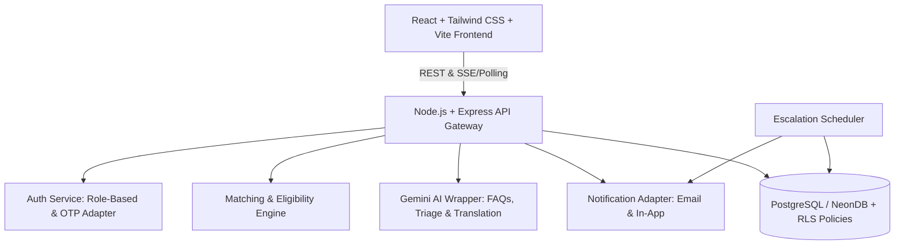

# Implementation Plan: LifeLink Verified Coordination Platform

LifeLink is a **verified coordination platform** designed for emergency blood and organ donation coordination under strict medical supervision. It is explicitly **not** a medical decision-making or organ allocation system. Official organ allocation resides strictly with NOTTO/ROTTO/SOTTO, and general blood stock availability links to e-RaktKosh.

---

## 1. System Architecture



### Core Architectural Principles
1. **Separation of Concerns**:
   - `client/`: Single Page Application (SPA) using React Router, Tailwind CSS, Lucide icons, and Leaflet + OpenStreetMap.
   - `server/`: Modular Node.js / Express backend with robust service layers, controllers, and middleware.
2. **Dual-Tier Database Support**:
   - Production/Staging: PostgreSQL on **NeonDB** with connection pooling and Row Level Security (RLS).
   - Local/Demo Fallback: Zero-friction database adapter running standard PostgreSQL queries (or SQLite dialect bridge for immediate offline local hackathon testing), ensuring instant startup while maintaining 100% PostgreSQL schema compatibility.
3. **Privacy by Design**:
   - Donor's exact phone number and GPS coordinates are strictly masked by backend serialization until an explicit match acceptance record exists.
   - Haversine approximate distance (e.g., "~3.2 km away in Bandra West") is computed server-side and presented beforehand.
4. **AI Guardrails (Gemini API Server-Side Wrapper)**:
   - System prompts enforce that Gemini acts purely as a coordinator assistant and multilingual form helper.
   - Hardcoded guardrail: AI **never** diagnoses, **never** declares clinical eligibility, and always appends mandatory medical disclaimers directing users to certified physicians.

---

## 2. Complete Database Schema (PostgreSQL / NeonDB)

### 2.1 Enums and Types
- `user_role`: `'requester' | 'donor' | 'doctor' | 'admin'`
- `blood_group`: `'A+' | 'A-' | 'B+' | 'B-' | 'AB+' | 'AB-' | 'O+' | 'O-'`
- `blood_component`: `'whole_blood' | 'packed_rbc' | 'platelets' | 'plasma'`
- `request_urgency`: `'critical_immediate' | 'urgent_within_24h' | 'planned'`
- `request_status`: `'pending' | 'verified' | 'rejected' | 'fulfilled' | 'expired'`
- `match_status`: `'notified' | 'accepted' | 'declined' | 'expired'`

### 2.2 Tables Definition

```sql
-- 1. Users Table (Core Auth & Roles)
CREATE TABLE users (
    id UUID PRIMARY KEY DEFAULT gen_random_uuid(),
    email VARCHAR(255) UNIQUE NOT NULL,
    password_hash VARCHAR(255) NOT NULL,
    role VARCHAR(50) NOT NULL CHECK (role IN ('requester', 'donor', 'doctor', 'admin')),
    full_name VARCHAR(255) NOT NULL,
    phone VARCHAR(20) NOT NULL,
    phone_verified BOOLEAN DEFAULT FALSE,
    is_active BOOLEAN DEFAULT TRUE,
    created_at TIMESTAMP WITH TIME ZONE DEFAULT NOW(),
    updated_at TIMESTAMP WITH TIME ZONE DEFAULT NOW()
);

-- 2. Hospitals Table
CREATE TABLE hospitals (
    id UUID PRIMARY KEY DEFAULT gen_random_uuid(),
    name VARCHAR(255) NOT NULL,
    registration_number VARCHAR(100) UNIQUE NOT NULL,
    address TEXT NOT NULL,
    city VARCHAR(100) NOT NULL,
    state VARCHAR(100) NOT NULL,
    lat DOUBLE PRECISION NOT NULL,
    lng DOUBLE PRECISION NOT NULL,
    phone VARCHAR(50) NOT NULL,
    email VARCHAR(255) NOT NULL,
    is_verified BOOLEAN DEFAULT TRUE,
    emergency_contact VARCHAR(100),
    created_at TIMESTAMP WITH TIME ZONE DEFAULT NOW()
);

-- 3. Doctors Table (Hospital Verifiers)
CREATE TABLE doctors (
    id UUID PRIMARY KEY DEFAULT gen_random_uuid(),
    user_id UUID NOT NULL REFERENCES users(id) ON DELETE CASCADE,
    hospital_id UUID NOT NULL REFERENCES hospitals(id) ON DELETE CASCADE,
    medical_license_number VARCHAR(100) UNIQUE NOT NULL,
    specialization VARCHAR(100) DEFAULT 'General Medicine',
    is_verified BOOLEAN DEFAULT TRUE,
    created_at TIMESTAMP WITH TIME ZONE DEFAULT NOW()
);

-- 4. Donors Table
CREATE TABLE donors (
    id UUID PRIMARY KEY DEFAULT gen_random_uuid(),
    user_id UUID NOT NULL REFERENCES users(id) ON DELETE CASCADE,
    blood_group VARCHAR(10) NOT NULL,
    city VARCHAR(100) NOT NULL,
    state VARCHAR(100) NOT NULL,
    lat DOUBLE PRECISION NOT NULL,
    lng DOUBLE PRECISION NOT NULL,
    approx_area VARCHAR(150),
    last_donation_date DATE,
    is_available BOOLEAN DEFAULT TRUE,
    consent_given_at TIMESTAMP WITH TIME ZONE DEFAULT NOW(),
    medical_notes_self_reported TEXT,
    created_at TIMESTAMP WITH TIME ZONE DEFAULT NOW(),
    updated_at TIMESTAMP WITH TIME ZONE DEFAULT NOW()
);

-- 5. Blood Requests Table
CREATE TABLE blood_requests (
    id UUID PRIMARY KEY DEFAULT gen_random_uuid(),
    requester_id UUID NOT NULL REFERENCES users(id) ON DELETE CASCADE,
    patient_name VARCHAR(255) NOT NULL,
    hospital_id UUID NOT NULL REFERENCES hospitals(id) ON DELETE RESTRICT,
    doctor_id UUID REFERENCES doctors(id) ON DELETE SET NULL,
    blood_group VARCHAR(10) NOT NULL,
    component VARCHAR(50) DEFAULT 'whole_blood',
    units_needed INTEGER NOT NULL CHECK (units_needed > 0),
    urgency VARCHAR(50) NOT NULL DEFAULT 'urgent_within_24h',
    required_by TIMESTAMP WITH TIME ZONE NOT NULL,
    status VARCHAR(50) NOT NULL DEFAULT 'pending',
    doctor_notes TEXT,
    rejection_reason TEXT,
    lat DOUBLE PRECISION NOT NULL,
    lng DOUBLE PRECISION NOT NULL,
    created_at TIMESTAMP WITH TIME ZONE DEFAULT NOW(),
    verified_at TIMESTAMP WITH TIME ZONE,
    fulfilled_at TIMESTAMP WITH TIME ZONE
);

-- 6. Request Matches Table (Donor Responses & Privacy Gating)
CREATE TABLE request_matches (
    id UUID PRIMARY KEY DEFAULT gen_random_uuid(),
    request_id UUID NOT NULL REFERENCES blood_requests(id) ON DELETE CASCADE,
    donor_id UUID NOT NULL REFERENCES donors(id) ON DELETE CASCADE,
    distance_km DOUBLE PRECISION NOT NULL,
    status VARCHAR(50) NOT NULL DEFAULT 'notified',
    notified_at TIMESTAMP WITH TIME ZONE DEFAULT NOW(),
    responded_at TIMESTAMP WITH TIME ZONE,
    UNIQUE (request_id, donor_id)
);

-- 7. Donations Table (Audit Record Logged by Doctors)
CREATE TABLE donations (
    id UUID PRIMARY KEY DEFAULT gen_random_uuid(),
    request_id UUID REFERENCES blood_requests(id) ON DELETE SET NULL,
    donor_id UUID NOT NULL REFERENCES donors(id) ON DELETE CASCADE,
    doctor_id UUID NOT NULL REFERENCES doctors(id) ON DELETE RESTRICT,
    hospital_id UUID NOT NULL REFERENCES hospitals(id) ON DELETE RESTRICT,
    blood_group VARCHAR(10) NOT NULL,
    component VARCHAR(50) NOT NULL,
    units_donated INTEGER NOT NULL DEFAULT 1,
    donation_date DATE NOT NULL DEFAULT CURRENT_DATE,
    verified_by_doctor_at TIMESTAMP WITH TIME ZONE DEFAULT NOW(),
    notes TEXT,
    created_at TIMESTAMP WITH TIME ZONE DEFAULT NOW()
);

-- 8. Organ Pledges Table (Awareness, Intent & Kin Record)
CREATE TABLE organ_pledges (
    id UUID PRIMARY KEY DEFAULT gen_random_uuid(),
    user_id UUID REFERENCES users(id) ON DELETE SET NULL,
    full_name VARCHAR(255) NOT NULL,
    date_of_birth DATE NOT NULL,
    blood_group VARCHAR(10),
    organs_pledged TEXT[] NOT NULL,
    kin_name VARCHAR(255) NOT NULL,
    kin_phone VARCHAR(50) NOT NULL,
    kin_relation VARCHAR(50) NOT NULL,
    kin_notified BOOLEAN DEFAULT FALSE,
    consent_timestamp TIMESTAMP WITH TIME ZONE DEFAULT NOW(),
    official_registry_redirect_clicked BOOLEAN DEFAULT FALSE,
    created_at TIMESTAMP WITH TIME ZONE DEFAULT NOW()
);

-- 9. Coordinator Logs Table (Hospital Transplant Counselor Log)
CREATE TABLE coordinator_logs (
    id UUID PRIMARY KEY DEFAULT gen_random_uuid(),
    hospital_id UUID NOT NULL REFERENCES hospitals(id) ON DELETE CASCADE,
    coordinator_user_id UUID NOT NULL REFERENCES users(id) ON DELETE CASCADE,
    patient_identifier VARCHAR(100) NOT NULL,
    conversation_date TIMESTAMP WITH TIME ZONE DEFAULT NOW(),
    family_members_present VARCHAR(255) NOT NULL,
    outcome_notes TEXT NOT NULL,
    notto_notified BOOLEAN DEFAULT FALSE,
    created_at TIMESTAMP WITH TIME ZONE DEFAULT NOW()
);

-- 10. Notifications Table
CREATE TABLE notifications (
    id UUID PRIMARY KEY DEFAULT gen_random_uuid(),
    user_id UUID NOT NULL REFERENCES users(id) ON DELETE CASCADE,
    title VARCHAR(255) NOT NULL,
    message TEXT NOT NULL,
    type VARCHAR(50) NOT NULL,
    is_read BOOLEAN DEFAULT FALSE,
    metadata_json JSONB,
    created_at TIMESTAMP WITH TIME ZONE DEFAULT NOW()
);

-- 11. Audit Logs Table (DPDP & Medical Verification Tracking)
CREATE TABLE audit_logs (
    id UUID PRIMARY KEY DEFAULT gen_random_uuid(),
    user_id UUID REFERENCES users(id) ON DELETE SET NULL,
    action VARCHAR(100) NOT NULL,
    resource_type VARCHAR(100) NOT NULL,
    resource_id VARCHAR(100),
    ip_address VARCHAR(50),
    details_json JSONB,
    created_at TIMESTAMP WITH TIME ZONE DEFAULT NOW()
);

-- 12. Hospital Policies Table (Configurable Eligibility Rules)
CREATE TABLE hospital_policies (
    id UUID PRIMARY KEY DEFAULT gen_random_uuid(),
    hospital_id UUID REFERENCES hospitals(id) ON DELETE CASCADE,
    whole_blood_gap_days INTEGER DEFAULT 90,
    plasma_gap_days INTEGER DEFAULT 14,
    platelets_gap_days INTEGER DEFAULT 7,
    escalation_timeout_mins INTEGER DEFAULT 30,
    escalation_radius_km DOUBLE PRECISION DEFAULT 25.0,
    created_at TIMESTAMP WITH TIME ZONE DEFAULT NOW()
);
```

### 2.3 Essential Indexes & Row Level Security (RLS)
- **Indexes**:
  - `CREATE INDEX idx_donors_location ON donors(lat, lng);`
  - `CREATE INDEX idx_donors_blood_group ON donors(blood_group);`
  - `CREATE INDEX idx_requests_status ON blood_requests(status);`
  - `CREATE INDEX idx_requests_duplicate_check ON blood_requests(patient_name, hospital_id, blood_group, status);`
- **RLS Policies**:
  - `donors`: Public/anonymous cannot query `phone` or exact `lat`/`lng`. Requesters only see donor phone when `request_matches.status = 'accepted'` for their specific request.
  - `blood_requests`: Requesters can see their own requests. Doctors can see all pending requests for their hospital. Only `status = 'verified'` requests are visible to matching donors.
  - `audit_logs`: Read-only for admins; insert-only for the application server.

---

## 3. Project Structure

```
Olympus2K26/
├── client/                     # Frontend React (Vite) App
│   ├── public/                 # Static assets, logos, leaflets markers
│   ├── src/
│   │   ├── assets/
│   │   ├── components/         # Reusable UI components
│   │   │   ├── ui/             # Buttons, Cards, Inputs, Modals, Badges, Tabs
│   │   │   ├── layout/         # Header, Footer (disclaimers), Navbar, Sidebar
│   │   │   ├── maps/           # LeafletMap, LocationPicker, DonorPin, HospitalPin
│   │   │   ├── ai/             # AiAssistantModal, VoiceInputButton, TriageDraftCard
│   │   │   └── common/         # DisclaimerBanner, StatusTimeline, CompatibilityBadge
│   │   ├── contexts/           # AuthContext, NotificationContext, DemoContext
│   │   ├── hooks/              # useAuth, useGeolocation, useAiAssistant
│   │   ├── pages/              # Primary Route Views
│   │   │   ├── Home.tsx                # Emergency 2-button landing page
│   │   │   ├── Login.tsx               # Email + OTP login & Forgot Password
│   │   │   ├── Register.tsx            # Role-specific onboarding
│   │   │   ├── requester/
│   │   │   │   ├── CreateRequest.tsx   # Blood request form with AI assistant
│   │   │   │   └── RequestDetail.tsx   # Real-time status timeline & donor tracking
│   │   │   ├── donor/
│   │   │   │   ├── DonorDashboard.tsx  # Availability, incoming requests, history
│   │   │   │   └── EligibilityCheck.tsx# Cooldown calculator + pre-screen info
│   │   │   ├── doctor/
│   │   │   │   ├── DoctorQueue.tsx     # Pending request verification & duplicate check
│   │   │   │   └── LogDonation.tsx     # Verify donation & update cooldown
│   │   │   ├── organ/
│   │   │   │   ├── OrganPledgeGuide.tsx# Plain-English guide + NOTTO external link
│   │   │   │   └── CoordinatorLog.tsx  # Hospital counselor family consent log
│   │   │   ├── admin/
│   │   │   │   └── AdminDashboard.tsx  # Impact metrics, hospitals, audit logs
│   │   │   └── DemoMode.tsx            # 2-minute simulated automated hackathon walkthrough
│   │   ├── services/           # api.ts, ai.ts, bloodMatching.ts
│   │   ├── types/              # TypeScript definitions for requests, donors, etc.
│   │   ├── App.tsx             # Route configuration
│   │   ├── index.css           # Tailwind + Custom theme (Red & Warm White palette)
│   │   └── main.tsx
│   ├── index.html
│   ├── package.json
│   ├── tailwind.config.js
│   └── vite.config.ts
├── server/                     # Backend Node.js / Express App
│   ├── src/
│   │   ├── config/             # DB connection, env vars, Gemini config
│   │   ├── controllers/        # Auth, Request, Match, Donation, Organ, AI, Admin
│   │   ├── middleware/         # authMiddleware (JWT/Role), rateLimiter, errorHandler
│   │   ├── models/             # Schema definitions & database abstraction layer
│   │   ├── routes/             # authRoutes, requestRoutes, donorRoutes, aiRoutes, etc.
│   │   ├── services/
│   │   │   ├── bloodCompatibility.ts # Compatibility tables (RBC / Plasma / Platelets)
│   │   │   ├── eligibilityService.ts # Configurable interval calculation
│   │   │   ├── matchingService.ts    # Haversine distance, compatibility & privacy filter
│   │   │   ├── otpAdapter.ts         # Mock OTP with pluggable Twilio/SMS interface
│   │   │   ├── emailAdapter.ts       # Mock / Nodemailer / Resend pluggable interface
│   │   │   ├── geminiService.ts      # Server-side Gemini API with safety guardrails
│   │   │   └── escalationWorker.ts   # Auto-escalation of unattended requests
│   │   ├── seeds/              # Seed script (50 donors, 3 hospitals, 2 doctors, 5 requests)
│   │   ├── tests/              # Matching, eligibility, privacy tests
│   │   └── app.ts              # Express initialization
│   ├── package.json
│   └── tsconfig.json
├── .env.example                # Template with GEMINI_API_KEY, DATABASE_URL, etc.
└── README.md                   # Setup steps, architecture diagram & 2-minute demo guide
```

---

## 4. Key Business Logic & Privacy Rules

### 4.1 Blood Group Compatibility Table
```typescript
export const BLOOD_COMPATIBILITY: Record<string, string[]> = {
  // Recipient Group -> Allowed Donor Groups
  'O-':  ['O-'],
  'O+':  ['O-', 'O+'],
  'A-':  ['O-', 'A-'],
  'A+':  ['O-', 'O+', 'A-', 'A+'],
  'B-':  ['O-', 'B-'],
  'B+':  ['O-', 'O+', 'B-', 'B+'],
  'AB-': ['O-', 'A-', 'B-', 'AB-'],
  'AB+': ['O-', 'O+', 'A-', 'A+', 'B-', 'B+', 'AB-', 'AB+']
};
```

### 4.2 Configurable Eligibility Calculation
- Default minimum gaps:
  - Whole Blood: **90 days** (configurable per hospital policy)
  - Platelets: **7 days**
  - Plasma: **14 days**
- Status computation:
  `daysSinceLastDonation >= gapDays` ? `"Eligible by interval (pending doctor screening)"` : `"Cooldown active (X days remaining)"`.

### 4.3 Strict Privacy Rule: Phone Masking
- When querying matching donors or broadcasting requests:
  - `donor.phone` is redacted to `null` or `+91-XXXXX-XXXXX`.
  - `donor.lat`/`lng` are rounded or displayed only as relative distance (e.g. `approx_distance_km: 2.4`).
- Only when `request_matches.status === 'accepted'`, an endpoint unlocks the direct phone contact and mutual Leaflet coordinate display.

### 4.4 AI Guardrails & Multi-language Prompt
- Gemini prompt includes strict system instruction:
  > *"You are the LifeLink Coordination Assistant. You assist users in navigating donation logistics, understanding FAQ policies, and structuring emergency request text. You MUST NOT diagnose symptoms, declare a user medically eligible or ineligible, or offer treatment opinions. Always include the disclaimer: 'LifeLink is a coordination platform. Final eligibility is determined solely by a qualified medical practitioner.' Support English, Hindi, and Marathi."*

---

## 5. Development Phases

| Phase | Description | Deliverables |
|---|---|---|
| **Phase 1: Foundation & Data Layer** | Backend setup, DB migrations with RLS, auth system (Email + OTP adapter, forgot password), user roles, seed scripts. | Express server running, DB schema in place, Auth API tested, Seed data loaded (50 donors, 3 hospitals, 2 doctors). |
| **Phase 2: Core Blood Flows** | Donor registration & availability toggle, Blood request form (patient, hospital, urgency, component), Duplicate request detector, Leaflet location picker. | Donor portal, Request creation flow, UI disclaimers, Map view. |
| **Phase 3: Doctor Verification, Matching & Privacy** | Doctor verification queue, Location-based matching engine, Contact privacy gating, Doctor donation logging & audit log, Escalation worker. | Request approved -> broadcast -> donor notified -> donor accepts -> contact unlocked -> donation logged. Automated tests for matching & privacy. |
| **Phase 4: Gemini AI Assistant** | Server-side Gemini API wrapper, Multilingual voice/text assistant (EN/HI/MR), Emergency text intake -> structured draft converter. | Interactive AI assistant drawer, structured request draft autofill, safety guardrail verification. |
| **Phase 5: Organ Donation Module** | Organ pledge educational guide, NOTTO official registry link-outs, internal pledge intent + next-of-kin notification, Hospital coordinator conversation log. | Organ pledge flow, coordinator dashboard, clear awareness-only positioning. |
| **Phase 6: Polish, Impact Dashboard & 2-Min Demo Mode** | Impact metrics dashboard (fulfilled requests, response time, donor stats), One-Click 2-Minute Demo Mode simulator, README, responsive polish. | Polished mobile & desktop experience, full walkthrough validation. |

---

## 6. Risks and Mitigation Strategies

1. **Risk: External Database Availability (NeonDB cold starts or missing credentials during local evaluation)**
   - *Mitigation*: The database layer will feature dual-mode capability: if `DATABASE_URL` is set, it connects directly to PostgreSQL / NeonDB. If not provided during initial local testing, it automatically initializes an embedded local PostgreSQL/SQLite storage adapter running the identical SQL schema so reviewers can clone and run in 10 seconds without cloud setup.
2. **Risk: Gemini API rate limits or missing API key in reviewer environment**
   - *Mitigation*: The AI service will have intelligent fallback mock responses for emergency intake and FAQs in English, Hindi, and Marathi if `GEMINI_API_KEY` is not supplied, ensuring the demo never breaks.
3. **Risk: Medical Liability & Regulatory Compliance**
   - *Mitigation*: Clear disclaimers prominently affixed to the header, footer, request forms, and AI output. Explicit links to official authorities: **e-RaktKosh** for blood stock and **NOTTO** for organ registry.
4. **Risk: Git Repository Restriction**
   - *Mitigation*: User explicitly specified *"Do not initialize the github repo and use node.js for backend"*. No `git init` will be executed; all files will be managed directly in the project directory with standard Node.js scripts.

---

## 7. Verification and Testing Plan

1. **Unit & Integration Tests**:
   - `tests/matching.test.ts`: Verify O- can donate to all, AB+ can receive from all; verify non-compatible groups are filtered out.
   - `tests/eligibility.test.ts`: Verify interval calculation with configurable hospital policies (90 days, 7 days, 14 days).
   - `tests/privacy.test.ts`: Verify that unaccepted matches NEVER return phone numbers or exact coordinates.
2. **Browser & UI Verification**:
   - Test on desktop and mobile viewports.
   - Verify 2-minute demo mode completes the full cycle: request creation -> doctor approval -> donor match -> donor accept -> contact reveal -> donation logged.
   - Verify bilingual AI assistant conversation in English, Hindi, and Marathi.
